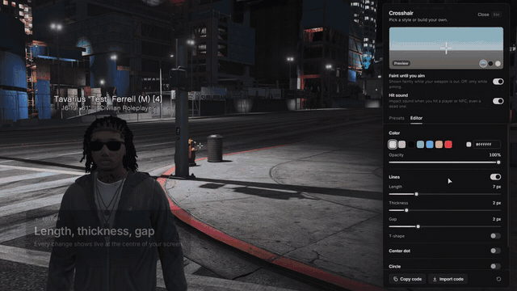
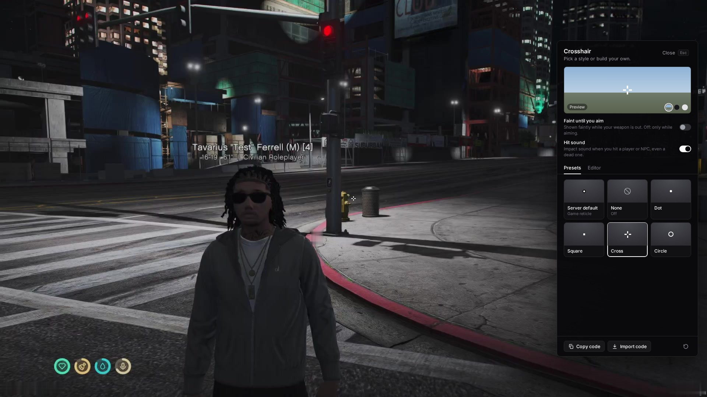
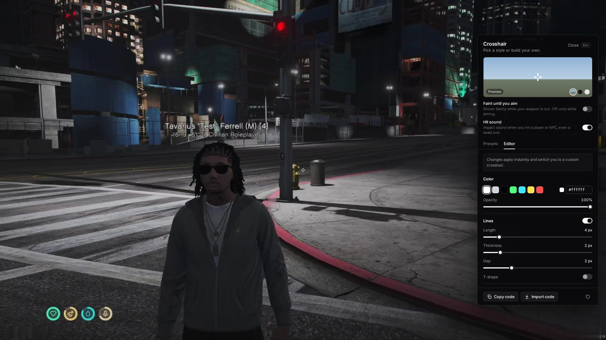

# cbz_crosshair

**Free & open-source (GPL-3.0).** A per-player crosshair selector for FiveM, made for roleplay servers.
Every player picks their own crosshair in a clean side menu — small, plain white presets or their own, built in a
live editor and shared with a code — while your server's own reticle stays the default. Standalone: no framework,
no database.



- **Presets** — small, clean, roleplay-ready: dot, square, cross, circle (or none at all).
- **Editor** — length, thickness, gap, T-shape, center dot, circle, colour, opacity, outline, with a live preview at
  the centre of your screen. Your own style is kept while you try presets.
- **Share codes** — copy a short `CBZ1-…` code, a friend pastes it.
- **Red on target** — like GTA, the crosshair turns red on players and NPCs, even once they are down.
- **Hit sound** — a realistic impact on every hit, players and NPCs, alive or dead.
- **Faint until you aim** — optional: a faint crosshair with your weapon out, sharp the moment you aim.
- **Gun behind a wall** — the crosshair fades when your shot would hit the cover in front of you.
- **Server control** — every option of the menu can be turned off in `config.lua`.

| Presets | Editor |
|---|---|
|  |  |

Developed by wthejulio · CBz Network.

## Requirements
- FiveM server (any recent artifact), `lua54`.
- Standalone: no framework, no database.

## Installation
1. Download `cbz_crosshair.zip` from the [latest release](https://github.com/c1pps/cbz_crosshair/releases/latest)
   and drop the `cbz_crosshair` folder into your `resources` folder.
2. Add it to `server.cfg` (anywhere after your streamed reticle resource, if you have one):
   ```
   ensure cbz_crosshair
   ```
3. Restart the server (or run `refresh` then `ensure cbz_crosshair` in the console).

**Windows (manual):** copy the folder to `C:\…\server-data\resources\cbz_crosshair`, open `server.cfg` in a text
editor, add `ensure cbz_crosshair` on its own line, save, then restart the server from txAdmin.

### Keeping your custom reticle
If your server streams its own reticle (a `hud_reticle.gfx` replacement), keep that resource as it is.
It is the **Server default** option of the menu: players who choose it see exactly your reticle.
Set `Config.Native.preview` to a style table (or a preset id) that looks like it — used for the menu tile only.

## Commands & keybinds
| Command | What it does |
|---|---|
| `/crosshair` | Opens the menu. Players can bind it in *Settings → Key Bindings → FiveM* (`Config.DefaultKey` to pre-bind). |
| `/crosshair reset` | Back to the server default, wipes the player's saved crosshair. |
| `/crosshair debug` | Prints in F8 what the script sees (aiming, scope, target…) each time it changes. Run again to stop. |

In the menu: **Esc** closes, changes apply and save instantly.

## How it works
- **Server default**: the game reticle (or your streamed one) is untouched.
- **Custom**: while a covered weapon is out, the game reticle is hidden and the chosen crosshair is drawn
  at the exact centre of the screen, scaled to the resolution (1080p, 1440p, 4K look the same).
- **None** (optional): no crosshair at all.
- The crosshair shows while aiming, like GTA. With the **Faint until you aim** switch on, it also shows faintly as
  soon as a weapon is out (on foot) and goes full opacity when you aim.
- **Like GTA**, the crosshair turns red while aiming at a ped — NPC or player, alive or dead (`Config.TargetColor`).
- **Hit sound**: a realistic bullet-impact sound when you hit a player or NPC with a firearm — alive or already
  dead (one per shotgun blast), picked at random among 3 variations so it never sounds repeated. Players turn it on
  or off in the menu; it works whatever crosshair they use, including the server default. More sets are included
  (flesh, headshot, meaty, body, punches, arcade tick).
- **Gun behind a wall**: when the camera sees past a wall your gun is behind (the "look bug" that anti-lookbug
  scripts block), the crosshair goes faint while you aim (`Config.DimWhenBlocked`).
- Snipers switch back to the real game scope while scoped in. Vehicle weapons and heavy weapons
  (lock-on indicators) always keep the game reticle.
- Settings are saved on the player's PC (resource KVP), so they survive reconnects and character switches.

## Configuration (`config.lua`, not encrypted)
| Option | Default | |
|---|---|---|
| `Config.Locale` | `'en'` | `locales/*.lua` (en, fr). Missing keys fall back to English. |
| `Config.Command` / `Config.DefaultKey` | `'crosshair'` / `''` | Command name, optional default key. |
| `Config.Default` | `'native'` | `'native'`, `'none'` or a preset id. |
| `Config.DefaultFaint` | `false` | *Faint until you aim* for players who never touched the switch. |
| `Config.FaintOpacity` | `35` | Opacity (%) of the faint crosshair (weapon out, not aiming). |
| `Config.DefaultHitSound` | `true` | Hit sound for players who never touched the switch. |
| `Config.HitSoundVolume` | `50` | Volume (%). |
| `Config.HitSoundFiles` | `visceral_1/2/3.ogg` | Sounds played at random. Every included set is listed in `config.lua`; or drop your own `.ogg` files in `web/sounds/`. |
| `Config.DimWhenBlocked` | `true` | Faint crosshair while your gun is behind a wall the camera sees past. |
| `Config.TargetColor` | `'#e03232'` | Colour while aiming at a ped, alive or dead. `false` = never change colour. Image presets keep their colours. |
| `Config.AllowNone` / `AllowFaint` / `AllowHitSound` / `AllowEditor` / `AllowShareCodes` | `true` | Remove each option from the menu. With the editor off, players choose presets only; with `AllowFaint` / `AllowHitSound` off, everyone gets the matching `Config.Default…`. |
| `Config.Native` | label + preview | The "Server default" tile (`preview` = `'gta'`, a preset id or a style table). |
| `Config.Swatches` | 7 colours | Editor colour swatches. |
| `Config.Presets` | Dot, Square, Cross, Circle | Small, plain white. Add your own vector presets, or PNG presets: put the file in `web/custom/` and use `image = 'custom/name.png', size = 24`. |
| `Config.WeaponGroups` | guns + throwables | Weapon groups that use the player's crosshair. |
| `Config.GameReticleWeapons` | `{}` | Weapons that always keep the game reticle. |
| `Config.Notify` | GTA feed | Plug your own notification system. |

## Share codes
*Copy code* puts a short `CBZ1-…` code in the clipboard; another player pastes it in *Import code*.
Codes only contain the crosshair style (image presets cannot be shared).

## Exports (client)
```lua
exports.cbz_crosshair:OpenMenu()
exports.cbz_crosshair:SetHidden(true)   -- hide every crosshair (cutscenes, cameras); false to release
local s = exports.cbz_crosshair:GetSettings() -- { mode, faint, hitSound, preset, style }
```
`SetHidden` is tracked per calling resource and released automatically when that resource stops.

## Tests
Pure logic is tested outside FiveM (natives stubbed the way FiveM returns them):
```bash
node --test tests/                    # crosshair model, SVG, share codes, config
lua5.4 tests/state_test.lua .         # visibility rules, look-bug rule, locales
lua5.4 tests/client_sim.lua .         # the real client script against stubbed natives
PLAYWRIGHT=/path/to/node_modules/playwright node tests/ui_e2e.js   # the menu in headless Chromium
```
FiveM's NUI runs an older Chromium (~102): run the menu test there too to catch layout differences.

## Credits & licenses
- Code: GPL-3.0 — see `LICENSE`. Developed by wthejulio · CBz Network.
- Font: Inter by The Inter Project Authors, SIL Open Font License 1.1 — see `web/fonts/OFL.txt`.
- Hit sounds (CC0, edited): *VisceralBulletImpacts* (u1769092), *Headshot* (Pablobd), *Three Flesh Impacts*
  (jawbutch), *Meaty Damage Impact* (modusmogulus), *Clothed Body Hit 1* (Flem0527) on freesound.org, and Kenney's
  *Impact Sounds* (www.kenney.nl).
